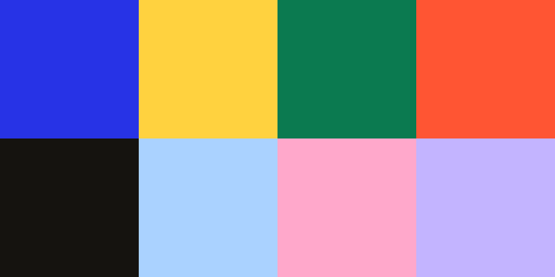

# cutouts

Twenty-five flat colour figures that draw themselves and answer the pointer. For React and for anything with a DOM.

[](https://www.npmjs.com/package/cutouts)
[](https://github.com/loadingthedev/cutouts/actions/workflows/ci.yml)
[](https://github.com/loadingthedev/cutouts/blob/main/LICENSE)



Live, with a slider for `intensity`: **[loadingthedev.github.io/cutouts](https://loadingthedev.github.io/cutouts/)**

Each figure is a flat geometric drawing on its own coloured field. It draws itself when it scrolls into view, and then the pointer does something to it that belongs to that figure alone: an eye follows it, scissors snip along a line, a chart scrubs, a switch flips.

A figure is a plain SVG string first. It renders on a server with no DOM and no script, complete, at its final size. The browser script only adds the motion.

## Install

```sh
npm i cutouts
```

No dependencies. ESM only. React 18 or later is an optional peer, needed only by `cutouts/react`.

## Use

### React

```tsx
import { Orbit } from "cutouts/react";

export function Hero() {
  return <Orbit />;
}
```

The figure fills its parent's width as a square. The entry is a client module, so a Server Component can render it with no `"use client"` of its own, and the drawing is in the server's HTML. Every component takes the options below and every `<div>` attribute, and forwards its ref to the `<div>`.

### Anything else

```ts
import { mount, orbit } from "cutouts";

const figure = mount(document.getElementById("figure")!, orbit, { play: true });

figure.update({ intensity: 0.8 });
figure.replay();
figure.destroy();
```

`mount` draws the figure into the element you give it. `update` changes `intensity`, `play` or `label` on the running figure, `replay` draws the entrance again, and `destroy` stops everything and leaves the drawing complete and still.

### On a server

```ts
import { orbit, svg } from "cutouts";

const html = svg(orbit); // "<svg ...>...</svg>"
```

`svg` needs no DOM. Send the string as it is and the figure is there before any script runs, so nothing shifts. To add the motion later, call `mount` on the `<svg>` or on an element that holds it; it adopts the drawing instead of making a new one.

In Astro:

```astro
---
import { orbit, svg } from "cutouts";
---

<div id="hero" set:html={svg(orbit, { wait: true })} />

<script>
  import { mount, orbit } from "cutouts";
  mount(document.getElementById("hero")!, orbit);
</script>
```

`wait` is for a figure that is in view when the page loads. Without it the figure shows complete, then the script arrives and starts it over. With it the parts stay back until `mount` draws them. This is done in CSS inside the string, so if the script never arrives the parts appear by themselves after three seconds.

## The figures

| Figure | Component | What it is | What the pointer does |
| --- | --- | --- | --- |
| `orbit` | `Orbit` | Three blue moons on a ring around a white disc. | The moons run round the ring to the pointer and gather where it touches. The disc leans after it. |
| `bars` | `Bars` | Three bars on a baseline, a red ball above the tallest. | Each bar reaches for the pointer as it passes. The ball rides the middle one. |
| `halves` | `Halves` | A disc split in two halves, blue and yellow, with a red ball above the gap. | The halves part as the pointer nears the seam, and the ball drops into the gap. |
| `rings` | `Rings` | Three rings with dots on them around a red centre. | The rings turn like dials as the pointer crosses, each at its own rate. The one under it swells. |
| `quarters` | `Quarters` | A disc in four coloured quarters with a dark centre. | The quarter the pointer is over pulls out of the disc, and the centre dot looks its way. |
| `dashboard` | `Dashboard` | An app window with a sidebar, two cards and a line chart ending in a red dot. | The red dot scrubs the chart to the pointer and the line draws up to it. The card under the pointer lifts. |
| `swap` | `Swap` | A pink disc on a yellow square, beside the empty dashed ring it came from. | The disc follows the pointer back to its empty ring in an arc, shrinking to fit, and the square tips as it leaves. |
| `release` | `Release` | Three boxes in a row, with an arrow curving from the last back to the one before. | The box under the pointer lifts and its dot swells. Over the first box, the arrow steps back one more. |
| `redline` | `Redline` | A page of text with one passage struck out in red and another added in blue. | The pointer scrubs the edit: to the left the strike is taken back and the blue passage closes up; to the right it is made again. |
| `crates` | `Crates` | Three stacked crates on the ground beside a red ball. | The top crate slides along the two below to stay under the pointer. The ball hops when the pointer comes near. |
| `phone` | `Phone` | A phone showing a picture, two lines of text and a button, with a red badge on its corner. | The phone tilts toward the pointer and its screen scrolls with the pointer’s height. The badge swells as the pointer nears it. |
| `checks` | `Checks` | Three rows, each a disc and a line: two blue discs and one red. | Each row is a slider. The disc in the pointer’s row runs along its line to the pointer. |
| `pair` | `Pair` | Two overlapping discs, blue and yellow, with a red dot where they meet. | The discs close over each other as the pointer nears the middle and part toward the edges. The red dot grows with the overlap. |
| `compose` | `Compose` | A text field holding two blocks, an empty dashed block and a red caret. | The caret jumps to the gap nearest the pointer and blinks there. The blocks beside it make room. |
| `chat` | `Chat` | Two chat bubbles, blue and white; the white one shows three typing dots. | The typing dots bounce in a wave while the pointer is there. The bubble nearer the pointer swells and the two slide apart. |
| `look` | `Look` | A round eye with a yellow iris under a raised brow. | The eye follows the pointer, the pupil a little ahead of the iris, and the brow tilts with it. |
| `dial` | `Dial` | A half-round gauge with a needle on a red hub, above a bar showing its reading. | The needle swings to point at the pointer, and the bar below fills to the same reading. |
| `toggle` | `Toggle` | A switch turned on, with its light lit. | The switch follows the pointer’s side: left turns it off and dims the light, right turns it back on. |
| `cradle` | `Cradle` | Three balls hanging in a row from a frame. | The cradle runs while the pointer is there: the end balls swing out in turn, further the nearer the pointer is to a side. |
| `dawn` | `Dawn` | A sun half risen over the sea, with a small red sail on the horizon. | The sun rises and sets with the pointer’s height and drifts after it. Its reflection widens as it climbs, and the boat rocks. |
| `dots` | `Dots` | A grid of white dots, one of them red. | The dots swell under the pointer and lean away from it, like a lens passing over the grid. |
| `select` | `Select` | A selection frame with a red handle around a yellow disc and a blue square; a pink disc sits outside it. | The pointer drags the red handle and the frame stretches after it. Shapes it takes in lift a little. |
| `keys` | `Keys` | Three keys above a wide space bar, each standing on its shadow. | The key under the pointer sinks flat onto its shadow, and the keys beside it dip. |
| `snip` | `Snip` | A pair of scissors open on a dashed cutting line. | The scissors travel along the line with the pointer, and snip as it moves. |
| `fan` | `Fan` | Three cards held in a fan, the front one marked with a red dot. | The hand turns toward the pointer and opens wider as the pointer rises. The card under it slides up out of the fan. |

`figures` is an array of all of them, in this order.

## Options

| Option | Type | Default | |
| --- | --- | --- | --- |
| `intensity` | `number` | `0.5` | How strongly the figure moves, from 0 (small and calm) to 1 (large and springy). A number outside 0…1 is clamped; anything that is not a number is 0.5. |
| `play` | `boolean` | `false` | Walks the figure through its answer on its own while it is in view, until a pointer arrives; it resumes after the pointer leaves. |
| `label` | `string` | a description in English | The accessible name. In React, `aria-label` does the same. |
| `field` | `boolean` | `true` | Draws the coloured field behind the figure. Without it the figure sits on your page's own colour and its parts may travel past the square. |
| `wait` | `boolean` | `false` in `svg`, `true` in React | Holds the parts back until the script draws them. See above. |

`svg` takes `label`, `field` and `wait`. `mount` takes `intensity`, `play` and `label`, and all five when it draws the figure itself.

## Theme

Ten colours, each a custom property. Set any of them on the figure or on anything above it:

```css
.figures {
  --cutouts-blue: #2733e6;
  --cutouts-red: #ff5533;
  --cutouts-sun: #ffd23f;
  --cutouts-pink: #ffa8cb;
  --cutouts-green: #0b7a50;
  --cutouts-sky: #a9d3ff;
  --cutouts-lilac: #c3b4ff;
  --cutouts-paper: #f3f2ee;
  --cutouts-ink: #15130f;
  --cutouts-white: #ffffff;
}
```

These are the defaults, and they are written into every figure as fallbacks, so a figure with no CSS at all has its colours. `palette` exports the same values.

## Notes

- **Accessibility.** A figure is an image (`role="img"`) with a description you can replace with `label`. It takes no focus and needs no keyboard.
- **Reduced motion.** With `prefers-reduced-motion`, a figure is complete and still: no entrance, no `play`, no answer to the pointer.
- **Touch.** A touch moves the figure the way a pointer does and it settles when the finger lifts. Nothing hovers on a touch screen, so `play` is how a figure shows its answer there.
- **Performance.** Every figure on a page shares one `requestAnimationFrame` loop. A figure at rest does no work, and the loop stops when nothing is moving. The entrance runs on the Web Animations API.
- **Size.** Measured with `bun build --minify` and `gzip -9` on version 0.1.0: one figure with `mount` is 6.2 kB (3.1 kB gzipped), all twenty-five are 26.3 kB (9.9 kB gzipped), and one figure with `svg` alone is 2.0 kB (1.2 kB gzipped). A figure you do not import is not in your bundle. A figure's SVG string is between 0.6 kB and 2.6 kB.

## Make your own

A figure is a plain object, and `svg` and `mount` take any object of that shape:

```ts
import { type Figure, mount } from "cutouts";

const blink: Figure = {
  name: "blink",
  label: "A white disc on blue",
  about: "The disc leans toward the pointer.",
  bg: "blue",
  shapes: () => [["circle", { cx: 100, cy: 100, r: 60, fill: "var(--cutouts-white,#fff)", "data-fx": "pop", "data-p": "disc" }]],
  answer: ({ x, y, k }) => ({ disc: { x: (x - 100) * 0.1 * k, y: (y - 100) * 0.1 * k } }),
};

mount(el, blink);
```

- The canvas is 200 by 200. A shape is `[element, attributes, children?]`.
- `data-fx` is how a shape enters: `draw` (a line draws itself; give it `pathLength="1"`), `pop`, `grow` (rises from its base) or `fade`. `data-x`, `data-y` and `data-rot` are where it enters from.
- `data-p` names a part. `answer` gets the pointer in canvas units (`x`, `y`), a clock in seconds (`t`) and the strength (`k`, 1 at the default intensity), and returns a pose for each part that should be away from rest: `x`, `y`, `r` (degrees), `s`, `sx`, `sy`, `o` (opacity) and `d` (how much of a drawn line is taken back). The engine springs every part toward its pose and back to rest when the pointer leaves.
- `data-at="100 100"` turns and scales a part about that point of the canvas instead of its own centre.

## Develop

```sh
bun install
bun test          # every figure, the options, mount in a DOM stub
bun run check     # the same promises in a real Chrome
bun run demo      # writes demo/dist/index.html
bun run shots     # contact sheets of every figure, to look at
bun run build     # dist/, plain ESM and types
bun run hero      # records assets/hero.gif (needs ffmpeg)
```

## License

MIT © Aftab Khan
